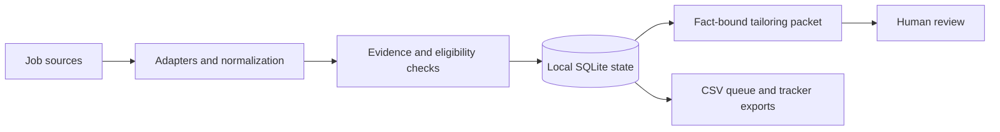

# Engineering Case Study: A Local Workflow With Auditable State

## Problem

Job-search workflows combine changing external records, duplicate URLs, private documents, uncertain model output, and state that must survive interrupted sessions. This project makes those concerns explicit in a local Python workflow rather than relying on chat history as the database.

## Data Flow

Private inputs and generated application artifacts stay local under the [data contract](../DATA_CONTRACT.md). A public checkout contains reusable code and example templates.

## Decisions and Tradeoffs

| Decision | Reason | Tradeoff |
| --- | --- | --- |
| SQLite as the local source of truth | Preserve structured records and workflow state across sessions | Appropriate for a local workflow; no claim of distributed execution or warehouse-scale throughput |
| CSV compatibility exports | Keep existing scripts and human-readable views usable | Exports are derived views and need reconciliation with database state |
| Explicit record identity and canonicalization | Reduce duplicate workflow records when posting URLs change | Identity depends on source quality and normalization rules |
| Deterministic screening before model-assisted work | Make eligibility decisions inspectable and avoid unnecessary downstream work | Rules need maintenance when job sources or requirements change |
| Evidence packets as the default tailoring path | Keep unsupported model claims reviewable and avoid an external LLM call by default | Human review remains necessary; optional provider paths have separate configuration |
| Pipeline locking | Coordinate local state-changing operations | Lock ownership and recovery behavior need explicit testing |

## Evidence Map

These are pointers to implementation and test cases, not performance benchmarks.

| Concern | Source | Verification |
| --- | --- | --- |
| Record identity, transitions, and exports | [job_store.py](../scripts/job_store.py) | [test_sqlite_workflow.py](../tests/test_sqlite_workflow.py), including URL upgrades without duplicate records and queue/tracker exports |
| Screening rules | [screen_job.py](../scripts/screen_job.py) | [test_screen_job.py](../tests/test_screen_job.py) |
| Discovery evidence | [verify_discovery_snapshot.py](../scripts/verify_discovery_snapshot.py) | [test_verify_discovery_snapshot.py](../tests/test_verify_discovery_snapshot.py) |
| Model output schema and provider boundaries | [tailor.py](../scripts/tailor.py) | [test_tailor_llm_validation.py](../tests/test_tailor_llm_validation.py), including no external LLM calls for the default provider |
| Local concurrency control | [pipeline_lock.py](../scripts/pipeline_lock.py) | [test_pipeline_lock.py](../tests/test_pipeline_lock.py) |
| Private-data checks | [security_check.py](../scripts/security_check.py) | [test_security_check.py](../tests/test_security_check.py) |

The [CI workflow](../.github/workflows/ci.yml) installs dependencies, runs unittest discovery, validates a public checkout, and scans for private data. Passing unit tests does not establish live job-board coverage, model quality, or browser reliability.

## Scope and Limitations

- This repository demonstrates workflow engineering and applied AI integration. It does not demonstrate model training, fine-tuning, or serving at scale.
- The local matching score is a prioritization heuristic, not a calibrated probability of interview success.
- No throughput, hiring outcome, or cost-reduction benchmark is claimed here.
- External sources can change or become unavailable; missing evidence must remain distinguishable from an empty result.
- Pattern-based security scanning is a guardrail and cannot prove the absence of all sensitive data.

## Next Evidence to Add

Useful follow-up work would include a fully synthetic end-to-end fixture with expected records, measured duplicate/error rates on that fixture, and an evaluation set for supported versus unsupported tailoring suggestions. These are proposed improvements, not completed capabilities.
